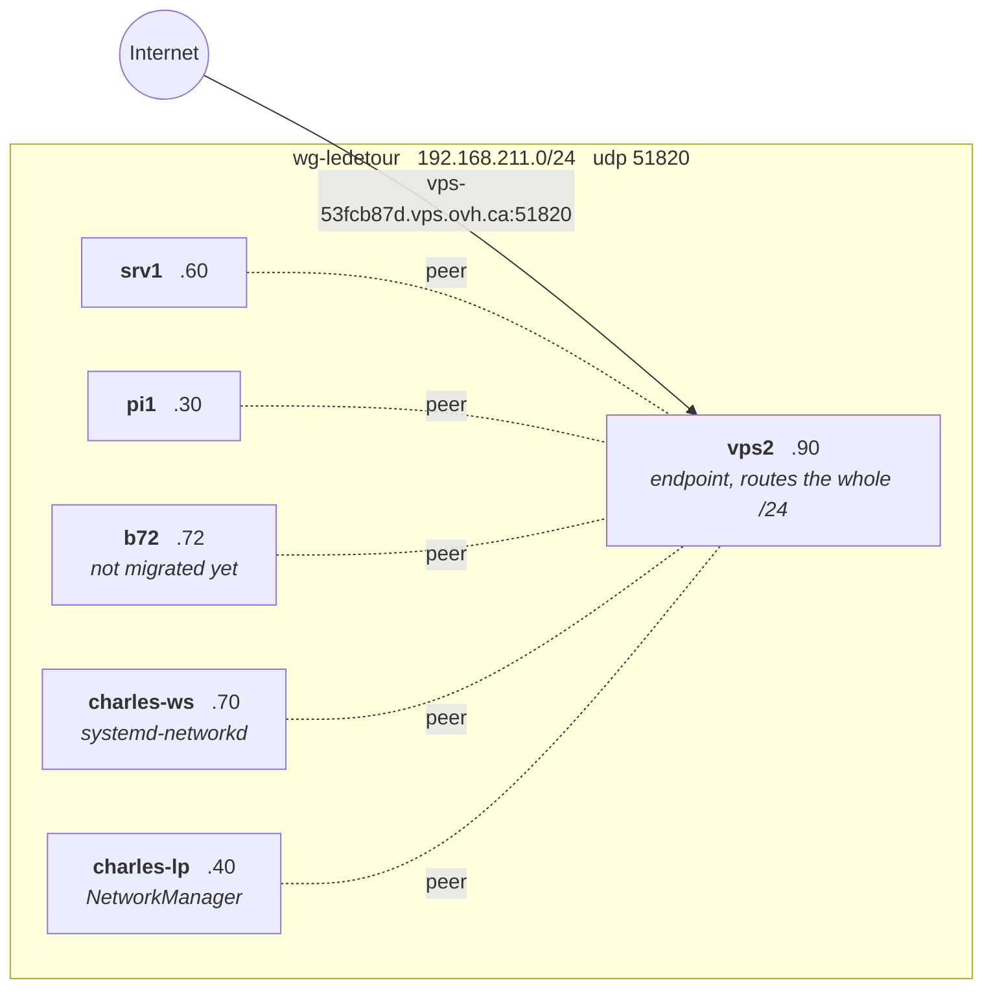
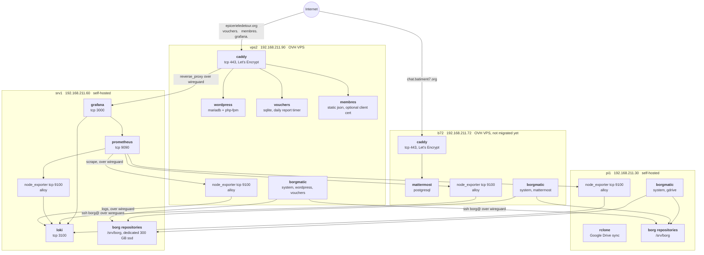

# ansible-automation

This repository contains the [Ansible](https://docs.ansible.com/projects/ansible/latest/getting_started/introduction.html) playbook and roles of the [Épicerie Le Détour](https://epicerieledetour.org/). It configures the different servers (VPS or self-hosted) and services (custom software, backup setups or third-party open source softwares) needed for the épicerie's mission, for example:
- multi store borg backups
- Google Drive proxies so the drives can be backuped on our systems
- Wordpress, Grafana and Mattermost instances
- Custom applications to [check members status](https://github.com/epicerieledetour/ledetour-membres) or to [scan the food vouchers](https://github.com/epicerieledetour/ledetour-vouchers) of the [Nourrir la Pointe](https://www.nourrirlapointe.ca/bons-solidaires) program.

A [Molecule](https://docs.ansible.com/projects/molecule/) setup allows development, experimentation and tests on safe, local virtual machines. Actual server deployment and upgrades are only ran when they are deemed to work well locally on a virtual network.


## Core values

### Code is the documentation

In a context where IT management is both mission critical for the organization but managed by volunteers with limited available time, Ansible allows to represent the desired state of the system by a single source of truth: the playbook. Manually configureing servers and services then documentating said configuration will without doubt lead to a desynchronisation between the real state of the systems and its documented state. With an [infrastructure-as-code](https://en.wikipedia.org/wiki/Infrastructure_as_code) system, the expected final state of the system is expressed as code, and the code acts as the documentation.


### Self-hosted Open Source Software

The Épicerie le Détour is a self-managed organization. It strives on do-it-yourself and continuous, community based improvements of culture and processes. These core values strongly matches those of OSS. From a technical point of view, Open Source allows to experiment, deploy and maintain a frictionless service stack without spending volunteer time in negociation and procurement with third-party commercial entities.

To further minimize dependencies, reduce friction and centralize configuration, third-party SaaS are kept to a minimum, [Slack](https://epicerieledetour.slack.com) and Google Drives being the current exceptions. Al other services are self-hosted and self-maintained.

Servers OS is [Debian](https://debian.org) and workstation setups must allow work on Debian.

### Centralized authentication

As we already use Google Apps for emails, calendars and shared drive, we use Google authentification services as much as possible. For exemple, Grafana or Wordpress accounts are accessed through the Google authentification services.


### Server and data security

Network security and absolute resistance to cracking is way beyond the reach of a volunteer-based grocery store. There is no expectation on the ability of the organization to defend itself against a targetted attack like a [DDoS](https://en.wikipedia.org/wiki/Denial-of-service_attack).

However, the Épicerie Le Détour tries to stick to common sense good practices.

- **Backup and redundancy**: all important data and document are automatically backuped on a regular basis and stored to several different physical locations. Google Drives are also regularly cloned and backuped in case Google revokes the Épicerie Le Détour account. 
- **Storage encryption**: by design, the Épicerie Le Détour tries to keep as little sensitive and personnal information as possible. Still, some documents are not meant to be shared. All self-hosted services are required to encrypt their data in case equiment is turned off and stolen.
- **HTTPS everywhere**: no public service is accessible on plain HTTP. SSL certificate are managed with [Let's Encrypt](https://letsencrypt.org)
- **Network ports are explicitely opened**: by default, all servers are fully firewalled from external connections. Ports are opened only when needed.
- **VPN to avoid router port forwarding**: as some servers are self-hosted, to minimize configuration and maintenance on home routers, all servers and workstation are isolated in their own VPN with [Wireguard](https://www.wireguard.com/).

### Private French, public English

The Épicerie le Détour is a French speaking organization that is open to the world:
- all internal documentation is written in French
- as one can't assume the reader's known language, all external documentation and code (including this repository) is written in English

## Infrastructure

### The Wireguard network

Every machine — servers and workstations alike — lives in a single Wireguard
network, `wg-ledetour`, on the `192.168.211.0/24` subnet, listening on UDP port
51820. The topology is a strict hub and spoke: `vps2` is the only host with
`wireguard_type: endpoint` (see `host_vars/vps2/vars.yml`) and every other host
is a `client` that declares `vps2` as its single peer.



Two consequences of that shape are worth keeping in mind:

- **Nothing talks peer to peer.** Clients set `AllowedIPs = 192.168.211.0/24`,
  and `vps2` enables `ip_forward` and accepts `FORWARD` on the interface
  (`roles/wireguard/templates/wg-ledetour-endpoint.conf.j2`), so traffic between
  two clients — a workstation reaching `srv1`, for instance — is routed *through*
  `vps2`. If `vps2` is down, the private network is down with it.
- **`vps2` is the only host that needs a reachable address.** It is the only
  machine whose `ansible_host` is a public name; the self-hosted servers are
  reached at their Wireguard address, which is why the very first production run
  of a new machine must be pointed at its LAN IP explicitly (see
  [First setup of a production machine](#first-setup-of-a-production-machine)).

### Services per machine



Grafana is never exposed to the internet directly: it only listens on the
Wireguard network, and `roles/grafana_proxy` templates a Caddy vsite on the web
server that reverse-proxies `grafana.epicerieledetour.org` to it. The same holds
for Loki and Prometheus, which are reachable from the Wireguard network only.

Every backup source writes to both `pi1` and `srv1`. `pi1` syncs the Google
Drives at 01:00 and all machines run their backups at 04:00, Montreal time.

| host | Wireguard IP | inventory groups | what runs on it |
|---|---|---|---|
| `vps2` | `192.168.211.90` | `servers`, `webservers`, `vouchers`, `backup_sources` | Wireguard endpoint, caddy, wordpress, vouchers, membres, grafana reverse proxy, borgmatic, node_exporter, alloy, ufw, fail2ban |
| `srv1` | `192.168.211.60` | `servers`, `grafana`, `backup_destinations` | grafana, loki, prometheus, borg repositories, node_exporter, alloy, ufw, fail2ban |
| `pi1` | `192.168.211.30` | `servers`, `backup_destinations`, `backup_sources`, `dataproxies` | borg repositories, Google Drive sync, borgmatic, node_exporter, alloy, ufw, fail2ban |
| `b72` | `192.168.211.72` | `servers`, `backup_sources`, `mattermost` | **Not migrated yet: production `b72` doesn't run this playbook.** Target state: Bâtiment 7's Mattermost (chat.batiment7.org), caddy, postgresql, borgmatic, node_exporter, alloy, ufw, fail2ban |
| `charles-ws` | `192.168.211.70` | `workstations_networkd` | Wireguard client only, configured through systemd-networkd |
| `charles-lp` | `192.168.211.40` | `workstations_nm` | Wireguard client only, configured through NetworkManager |

Workstation plays are tagged `never` and run only when explicitly asked for, see
[Wireguard on workstations](#wireguard-on-workstations).

`kiosk1` holds a `host_vars` entry, and therefore the reserved Wireguard address
`.80`, without being part of the active inventory yet.

## The Ansible setup

### The vault password file

This playbook uses [Ansible Vaults](https://docs.ansible.com/ansible/latest/user_guide/vault.html). The password file, GPG encryped and shared amongst Le Détour admins by an out-of-band mean of communication, is expected to be named `.vault_password.d/encrypted-vault-password-for-username` in this cloned repo root folder.

To add a new administrator that could run this ansible setup:

1. Add their ssh public key in the `keys` folder. Keep the same key name on their local workstation `~/.ssh` folder, the vault password decryption script uses this name to find the matching private key. For example, if the new administrator public key is `/home/username/.ssh/id_ed25519.pub`, then copy this key as `keys/username-id_ed25519.pub`
2. Decrypt the vault password and encrypt it using the new admin public key: `./vault_password.sh | age -R keys/username-id_ed25519.pub -o .vault_password.d/encrypted-vault-password-for-username`

These two steps only give the new administrator the vault password. The `keys` folder is the vault recipient store, not the ssh allowlist: the `authorized_keys` role writes `authorized_keys` exclusively from the names listed in `authorized_keys_allowed` (`group_vars/all/vars.yml`), and removes every other key from the servers. To also give the new administrator a shell on the servers, add their name to that list.


### Install system dependencies

On debian:

```sh
# age: to encrypt and decrypt the vault password
# the rest is for running ansible and the molecule virtual machines
sudo apt install \
    age \
    build-essential \
    cloud-image-utils \
    qemu-kvm \
    libguestfs-tools \
    libvirt-daemon-system \
    libvirt-dev \
    pkg-config \
    python3-dev
```

### Install `uv`

We use [`uv`](https://docs.astral.sh/uv/) to run Ansible and Molecule. Follow the instructions on that page to install it.

### Set up libvirt

The Molecule testing environment runs virtual machines managed by [`libvirt`](https://libvirt.org/). The user running the Molecule environment must be added to the `libvirt` group:

```bash
sudo usermod --append --groups libvirt `whoami`
newgrp libvirt
```

### Install Ansible dependencies

Install community package for creating and using roles:

**Probably not needed anymore**

```sh
ansible-galaxy collection install -r requirements.yml

# TODO: When Ansible 2.10 is released, this should be enough
# ansible-galaxy install -r requirements.yml
```

### Enable the pre-commit hook

Once per clone, let git run the repository's hooks, which lint each commit (see [Linting](#linting)):

```sh
git config core.hooksPath .githooks
```

### Wireguard on workstations

Servers and workstations are linked together by a wireguard network, `vps2` being the endpoint every other machine connects to. Workstations are never configured by default (their plays are tagged `never`): add the workstation to the `workstations_networkd` or `workstations_nm` group in `inventory/hosts.yml`, set its `wireguard_*` host vars, then run the playbook limited to that workstation with the matching tag:

```sh
# systemd-networkd, creates /etc/systemd/network/wg-ledetour.{netdev,network,key}
ansible-playbook playbook.yml --limit charles-ws --tags workstations_networkd
# NetworkManager, creates /etc/NetworkManager/system-connections/wg-ledetour.nmconnection
ansible-playbook playbook.yml --limit charles-lp --tags workstations_nm
```

Workstations are always local machines (`ansible_connection: local` on the `workstations` inventory group): run the playbook on the workstation itself, ansible never connects to them through ssh. Don't forget to rerun the `wireguard` tag on the servers so that `vps2` knows the new peer, and to open your firewall: UDP outbound port 51820.

## Production mode

```sh
ansible-playbook playbook.yml

```

This `playbook.yml` will setup all machines described in `inventory/` according to the configuration described in `/roles`. 

## First setup of a production machine

1. Install debian 13 (trixie)
2. Full disk encryption
3. Add a single user `debian`
4. Ensure openssh server is running
5. `ssh-copy-id` for the user / machine ansible will be ran from
6. Install `sudo`: `apt install sudo`
6. Configure user `debian` for passwordless sudo. Create a new file `/etc/sudoers.d/admin` with this content: `debian ALL=(ALL:ALL) NOPASSWD: ALL` (`(ALL:ALL)` matters: without it sudo only reaches root, and the backup tasks run as `borg`)
7. Run ansible against a first time with the LAN IP of the machine. This will bootstrap the Wireguard connection that will be used by default next time: `ansible-playbook -e "ansible_host=[LAN IP] ansible_user=debian" playbook.yml --limit [hostname]`, for example `ansible-playbook -e "ansible_user=debian ansible_host=192.168.1.42" playbook.yml --limit srv1`
8. The machine is likely to reboot on first ansible run: be ready to enter disk decryption keys

## Encrypt Sensitive Files

```sh
# Encrypt the secret file
ansible-vault encrypt --vault-id @prompt secret.yml

# View the content of the secret file, will ask for password
ansible-vault view secret.yml

# Decrypt the content of the secret file, will ask for password
ansible-vault decrypt secret.yml
```

### Setup Wireguard using config from Ansible

Ansible should have installed and configured wireguard automatically.

However, if you would like to configure it manually:

```bash
# TODO: use Ansible to only generate the wg config file

# Install wireguard for your Linux distribution
sudo apt install wg

# Setup the connection using the config file generated by 'ansible-playbook playbook.yml' at /etc/wireguard/wg-ledetour.conf 
sudo wg-quick up wg-ledetour

#Confirm your virtual interface and peers are setup
sudo wg show
```

You can now ping other machines in the vpn according to the IPs specified in `host_vars`.

If Ansible has added your public ssh keys to other machines in the wireguard network, you can now ssh into them using the username specified in `inventory/hosts.yml`.

## Developement

### Development environment

See [Install system dependencies](#install-system-dependencies) for the required packages.

We're using [Molecule](https://docs.ansible.com/projects/molecule/) to safely develop the Ansible playbook on local virtual machines without modifying the production servers.

```sh
# Creates and run the virtual machines
uv run molecule create

# Setup the virtual machines for local development
uv run molecule prepare

# Run the Ansible playbook on local virtual machines
uv run molecule converge

# Logging into a running virtual machine, for example vps2
uv run molecule login --host vps2

# Destroy all virtual machines
uv run molecule destroy
```

On a workstation with a restrictive firewall, `bin/open-charles-workstation-firewall-for-molecule.sh` temporarily lets the virtual machines through. It's specific to Charles's nftables and VPN setup: adapt it to yours.

### Linting

[ansible-lint](https://docs.ansible.com/projects/lint/) checks both the Ansible code and the YAML formatting:

```sh
# Whole repository, takes about 25 seconds
uv run ansible-lint

# Let ansible-lint fix what it can, then review the changes with git diff
uv run ansible-lint --fix
```

The pre-commit hook `.githooks/pre-commit` is versioned with the repository, but git only runs it once enabled in each clone with `git config core.hooksPath .githooks`. Before each commit, it:

1. runs ansible-lint on the staged `.yml` and `.yaml` files only, which takes a few seconds instead of the whole repository's 25;
2. syntax checks `playbook.yml`, which loads every role it uses, so a broken role is caught even when only a template is committed.

If either fails, the commit is aborted. When ansible-lint fails, the hook prints the `uv run ansible-lint --fix <files>` command to run on the staged files; review its changes, stage them and commit again. Files are linted as they are on disk, including unstaged changes. `git commit --no-verify` skips the hook in an emergency.

The repository passes ansible-lint without exceptions: fix new violations rather than ignoring them.

### Backups and restore

Creating and restoring backups are opt-in tags:

```bash
uv run molecule converge -- --tags vouchers --tags borgmatic_create
uv run molecule converge -- --tags vouchers --tags borgmatic_restore
uv run molecule converge -- --tags wordpress --tags borgmatic_create
```

### Testing that the services work

#### Automated checks

After a converge, check that the web services work as expected:

```bash
$ uv run molecule converge
$ uv run molecule verify
```

`molecule/default/verify.yml` checks wordpress, vouchers, membres, grafana and mattermost, and lists every failing check at the end.

The sections below describe how to test the services by hand, for instance to investigate a failure.

#### Web services

Exposing the web services on dynamic IPs assigned by Molecule over libvirt without modifying the ansible host itself can be tricky, requiring a mix of DNS masquerading, `/etc/hosts` configuration or complex molecule setups.

Fortunately, all web services are available as `https://servicename.localhost` on the web servers themselves (so we can ensure that they work correctly locally).

The easiest way to test web services is to redirect the web server ports 443 to the host port 443.

```bash
$ ssh -N -L 443:localhost:443 \
    -i ~/.ansible/tmp/molecule.*/id_ssh_rsa \
    molecule@10.10.10.152  # Connect to the webserver virtual machine to get its IP
```

Web services are then accessible from the host on `localhost`:

```bash
$ curl https://vouchers.localhost
$ firefox https://vouchers.localhost
```

#### Vouchers

```bash
ansible-host$ curl -kL https://vouchers.localhost
```

#### Membres

```bash
# Without client SSL, members.json should be anonymized
$ curl -skL https://membres.localhost/members.json | jq -r '{ members: {"333": .members."333"}, contains_private_data }'

{
  "members": {
    "333": {
      "active": true,
      "hours_in_bank": 61
    }
  },
  "contains_private_data": false
}

# With client SSL, members.json should not be anonymized
$ curl -skL --cert roles/membres/files/client.crt --key roles/membres/files/client.key https://membres.localhost/members.json | jq -r '{ members: {"333": .members."333"}, contains_private_data }'
{
  "members": {
    "333": {
      "active": true,
      "family_name": "Flèche",
      "first_name": "Charles",
      "phone": "********"
    }
  },
  "contains_private_data": true
}
```

#### Wordpress

```bash
$ curl -kL https://wordpress.localhost
```

Default login on a Molecule/dev environment is username `admin`, with the password stored (vault-encrypted) in `wordpress_admin_password` in `roles/wordpress/vars/main.yml` — view it with `ansible-vault view roles/wordpress/vars/main.yml`. In production, regular Wordpress users log in with their `@epicerieledetour.org` Google account; this `admin` account remains as a fallback.

#### Wordpress backups

Wordpress is backed up by borgmatic like the other services: the `wp-content` folder and a dump of the database, see `roles/wordpress/files/wordpress.yaml`.

#### Grafana

```bash
$ curl -kL https://grafana.localhost
```

On a Molecule/dev environment, Google OAuth is disabled, so login falls back to Grafana's built-in default account: username `admin`, password `admin` (Grafana forces a password change on first login). In production, Grafana is only reachable through Google OAuth (see `roles/grafana/templates/grafana.ini.j2`) — users log in with their `@epicerieledetour.org` Google account, and there is no separate local admin login.

